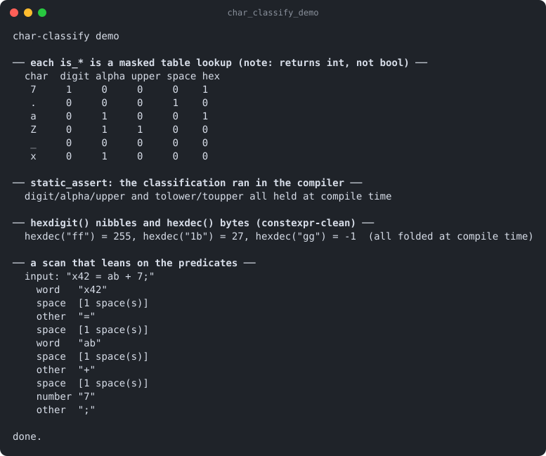

# char-classify

Part of [Kronuz C++ Libraries](https://github.com/Kronuz/cpp-libraries), a collection of small, reusable C++ libraries.

[](https://github.com/Kronuz/char-classify/actions/workflows/ci.yml)
[](LICENSE)


Character classification for C++20 without `<cctype>` or locales: `is_digit`,
`is_alpha`, `toupper`, hex digits, and more, as `constexpr` table lookups you can
use at compile time. For parsers and tokenizers that need fast, predictable,
locale-independent answers.



## ✨ Highlights

- **`constexpr` everything**: classify and convert in `static_assert`.
- **No locale, no `<cctype>`**: the same answer everywhere, with no global state.
- **One table lookup per question**: a 256-entry flag table, plus case and hex
  tables.
- **Hex helpers**: `hexdigit`, `hexdec` (two characters to a byte), `hex_value`
  (a byte-wide nibble table with a `0xff` sentinel), and `char_repr` (a byte to
  two hex characters).
- **Block scanning** (`chars_simd.hh`): find the first byte in a set, or outside
  a range, and fold ASCII case, 16 bytes at a time with NEON or SSE2 and 8 with a
  portable fallback.
- **The escaping kernel** (`chars_escape.hh`): the measure and write passes
  behind `escape()` and `repr()`.
- **Headers only, no dependencies.**

## 📦 Installation

Requires a C++20 compiler; CMake 3.14 or newer for the CMake route. CI builds it
on Linux (x86_64, arm64), macOS (arm64, x86_64), and FreeBSD, plus ASan, UBSan,
and TSan builds.

```cmake
include(FetchContent)
FetchContent_Declare(char_classify
  GIT_REPOSITORY https://github.com/Kronuz/char-classify.git
  GIT_TAG        main)
FetchContent_MakeAvailable(char_classify)

target_link_libraries(my_app PRIVATE char_classify::char_classify)
```

Or copy the headers onto your include path: `chars.hh`, and `chars_simd.hh` and
`chars_escape.hh` when you use them (`chars_escape.hh` includes the other two).

## 🚀 Quick start

```cpp
#include <string_view>

#include "chars.hh"
#include "chars_simd.hh"

static_assert(chars::is_digit('5'));
static_assert(chars::toupper('a') == 'A');
static_assert(chars::hexdigit('f') == 15);
static_assert(chars::hex_value('g') == chars::NO_HEX_VALUE);

int main() {
	const char* p = "ff";
	chars::hexdec(&p);                           // decodes two hex digits, advancing p

	std::string_view s = "a=1&b=2";
	chars::simd::FirstOf<2> sep('&', '=');
	const char* hit = sep.find(s.data(), s.data() + s.size());   // the '=' after "a"
	const char* bad = chars::simd::find_outside(s.data(), s.data() + s.size(), '0', '9');
	return hit - s.data() == 1 && bad == s.data() ? 0 : 1;
}
```

The `is_*` predicates return a masked flag, not a `bool`; compare to `0` when you
need one. [`examples/demo.cc`](examples/demo.cc) classifies a sample string.

Define `CHARS_NO_SIMD` before including `chars_simd.hh` to force the portable
backend; `chars::simd::backend` names the one compiled in (`"neon"`, `"sse2"` or
`"swar"`).

## 🎯 When to use it

- ✅ Lexers, parsers, and encoders that classify bytes in hot loops.
- ✅ Scanning a buffer for a few delimiters, or for the first byte outside a class.
- ❌ Unicode: it classifies single bytes.

## ⚡ Performance

A predicate is one load from a 256-entry table. `chars_simd.hh` tests 16 bytes per step with NEON or SSE2
(8 with the portable backend), and `chars_escape.hh` builds on it. `bench/compare.cc` measures the library
against arithmetic loops, `<cctype>`, `memchr` and abseil; both sides compute the same result, which is
checked before a row is timed (`--check` runs only the checks, and is a ctest when the option is on):

```sh
cmake -B build -DCMAKE_BUILD_TYPE=Release -DCHAR_CLASSIFY_BUILD_BENCH=ON && cmake --build build
./build/char_classify_compare [--check | FILTER]        # the target's backend
./build/char_classify_compare_swar                      # the same rows on the portable backend
```

`-O3`, Apple clang 17, abseil 20260817.0, the best of seven samples of at least 8 ms, on an Apple M4 Pro (NEON)
and an Intel i9-9980HK (SSE2). The i9 is shared and moves by up to 25% between runs; the ratio inside a run is
the evidence. Library time / comparator time, ns per byte:

| workload | M4 Pro | i9-9980HK |
|---|---:|---:|
| `is_alpha` count, 64 KB, against `(c \| 32) - 'a' < 26` (vectorized by the compiler) | 0.178 / 0.141 | 0.266 / 0.199 |
| `is_alpha` count, 64 KB, against `std::isalpha` | 0.178 / 0.433 | 0.263 / 1.107 |
| `is_alpha` count, 64 KB, against `absl::ascii_isalpha` | 0.175 / 0.176 | 0.265 / 0.266 |
| `is_hexdigit` count, 64 KB, against range arithmetic | 0.177 / 0.355 | 0.263 / 0.550 |
| `char_repr` hex encode, 256 B, against a nibble string lookup | 0.287 / 0.342 | 0.386 / 0.626 |
| `char_repr` hex encode, 256 B, against `absl::BytesToHexString` | 0.287 / 0.390 | 0.386 / 0.780 |
| `hexdec` decode, 4 KB, against arithmetic nibbles | 2.284 / 1.056 | 4.137 / 2.020 |
| `hex_value` decode, 4 KB, against arithmetic nibbles | 1.205 / 1.048 | 2.107 / 2.078 |
| `hex_value` decode, 4 KB, against `absl::HexStringToBytes` | 1.216 / 0.356 | 2.100 / 1.019 |
| `simd::ascii_lower`, 64 KB, against a `__restrict` arithmetic loop | 0.017 / 0.017 | 0.038 / 0.038 |
| `simd::ascii_lower`, 64 KB, against `chars::tolower` per byte | 0.017 / 0.194 | 0.037 / 0.372 |
| `simd::ascii_lower`, 16 B, against the arithmetic loop | 0.042 / 0.459 | 0.162 / 0.304 |
| `escape_measure` + `escape_emit`, 4 KB printable, against a two-pass table loop | 0.071 / 0.516 | 0.144 / 0.843 |
| the same, 4 KB text with 5% escapes | 0.157 / 0.528 | 0.351 / 0.842 |
| the same, 64 KB with one byte in ten random | 0.217 / 0.531 | 0.744 / 0.845 |

ns per call:

| workload | M4 Pro | i9-9980HK |
|---|---:|---:|
| `FirstOf<2>`, 256 B, no match, against `string_view::find_first_of` | 5.1 / 86 | 12.1 / 106 |
| `FirstOf<2>`, 4 KB, no match, against `string_view::find_first_of` | 94 / 1,075 | 185 / 1,484 |
| `find_outside('0', '9')`, 4 KB, against `std::find_if` | 83 / 1,095 | 129 / 1,384 |
| `FirstOf<1>`, 256 B, no match, against `memchr` | 4.7 / 6.0 | 8.9 / 6.2 |
| `FirstOf<1>`, 4 KB, no match, against `memchr` | 81 / 85 | 128 / 49 |

Where the library is not ahead: a compiler-vectorized arithmetic loop beats the table lookup of `is_alpha` by
1.3x, and matches `simd::ascii_lower` at 256 B and above. `FirstOf<1>` is `memchr`'s speed on NEON and 1.4x
to 2.6x slower than the system `memchr` on x86 from 256 B up, so one byte is a job for `memchr`. `hexdec`
(two digits, `-1` on bad input) takes twice as long as arithmetic; `hex_value` removes the difference, and
`absl::HexStringToBytes` is faster than both.

The portable backend (`char_classify_compare_swar`, built with `CHARS_NO_SIMD`) shows what the vector
backends buy. Portable time over native time: the 4 KB printable kernel row 2.0x (M4 Pro) and 3.4x (i9),
the 64 KB mixed row 2.4x and 3.6x, `FirstOf<2>` at 4 KB 2.9x and 3.3x, `ascii_lower` at 64 KB 1.9x and 1.4x.
On the portable backend the 64 KB mixed kernel row takes 1.0x (M4 Pro) and 3.1x (i9) the time of the scalar
table loop.

## 📚 Documentation

- [docs/API.md](docs/API.md): every predicate, conversion, scanner and the escaping kernel.
- [ARCHITECTURE.md](ARCHITECTURE.md): the tables and the block scanners.
- [CHANGELOG.md](CHANGELOG.md): what changed, with numbers.
- [AGENTS.md](AGENTS.md): repository map and traps.

## 🛠️ Building and testing

```sh
cmake -B build && cmake --build build && ctest --test-dir build
./build/char_classify_demo
```

## 🤝 Contributing

Issues and pull requests are welcome. Read [AGENTS.md](AGENTS.md) first. CI must
pass on every platform.

## 📄 License

MIT, Copyright (c) 2015-2019 Dubalu LLC. See [LICENSE](LICENSE). Extracted from
[Xapiand](https://github.com/Kronuz/Xapiand).
