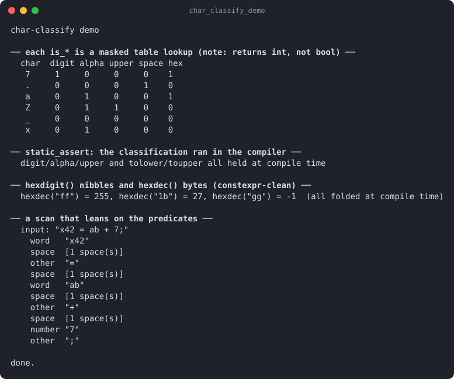

# char-classify

Part of [Kronuz C++ Libraries](https://github.com/Kronuz/cpp-libraries), a collection of small, reusable C++ libraries.

[](https://github.com/Kronuz/char-classify/actions/workflows/ci.yml)
[](LICENSE)


Character classification for C++20 without `<cctype>` or locales: `is_digit`,
`is_alpha`, `toupper`, hex digits, and more, as `constexpr` table lookups you can
use at compile time. For parsers and tokenizers that need fast, predictable,
locale-independent answers.



## ✨ Highlights

- **`constexpr` everything**: classify and convert in `static_assert`.
- **No locale, no `<cctype>`**: the same answer everywhere, with no global state.
- **One table lookup per question**: a 256-entry flag table, plus case and hex
  tables.
- **Hex helpers**: `hexdigit`, `hexdec` (two characters to a byte), and
  `char_repr` (a byte to two hex characters).
- **One header, no dependencies.**

## 📦 Installation

Requires a C++20 compiler; CMake 3.14 or newer for the CMake route. CI builds it
on Linux (x86_64, arm64), macOS (arm64, x86_64), and FreeBSD, plus ASan, UBSan,
and TSan builds.

```cmake
include(FetchContent)
FetchContent_Declare(char_classify
  GIT_REPOSITORY https://github.com/Kronuz/char-classify.git
  GIT_TAG        main)
FetchContent_MakeAvailable(char_classify)

target_link_libraries(my_app PRIVATE char_classify::char_classify)
```

Or copy `chars.hh` onto your include path. The header is named `chars.hh`.

## 🚀 Quick start

```cpp
#include "chars.hh"

static_assert(chars::is_digit('5'));
static_assert(chars::toupper('a') == 'A');
static_assert(chars::hexdigit('f') == 15);

int main() {
	const char* p = "ff";
	return chars::hexdec(&p) == 255 ? 0 : 1;   // decodes two hex digits, advancing p
}
```

The `is_*` predicates return a masked flag, not a `bool`; compare to `0` when you
need one. [`examples/demo.cc`](examples/demo.cc) classifies a sample string.

## 🎯 When to use it

- ✅ Lexers, parsers, and encoders that classify bytes in hot loops.
- ❌ Unicode: it classifies single bytes.

## 📚 Documentation

- [docs/API.md](docs/API.md): every predicate and conversion.
- [ARCHITECTURE.md](ARCHITECTURE.md): the tables.
- [AGENTS.md](AGENTS.md): repository map and traps.

## 🛠️ Building and testing

```sh
cmake -B build && cmake --build build && ctest --test-dir build
./build/char_classify_demo
```

## 🤝 Contributing

Issues and pull requests are welcome. Read [AGENTS.md](AGENTS.md) first. CI must
pass on every platform.

## 📄 License

MIT, Copyright (c) 2015-2019 Dubalu LLC. See [LICENSE](LICENSE). Extracted from
[Xapiand](https://github.com/Kronuz/Xapiand).
